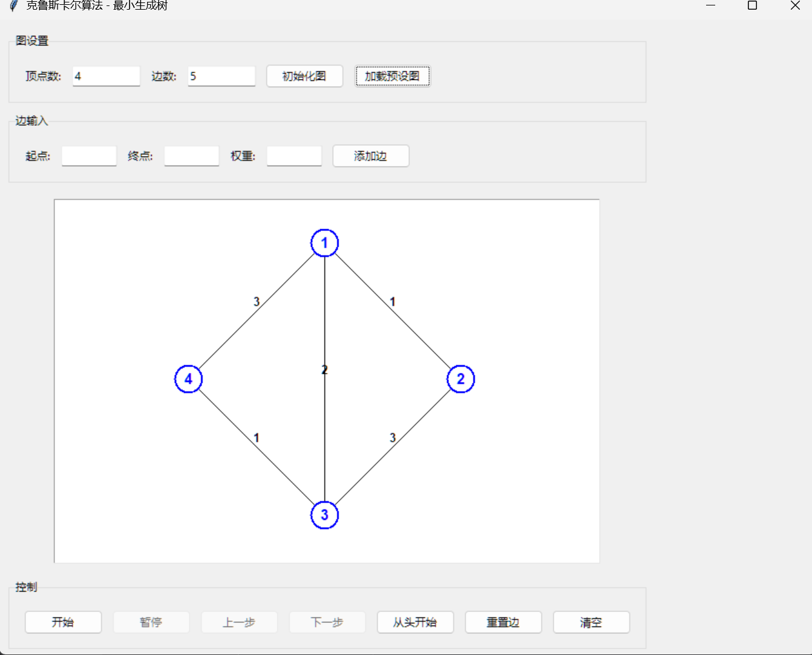
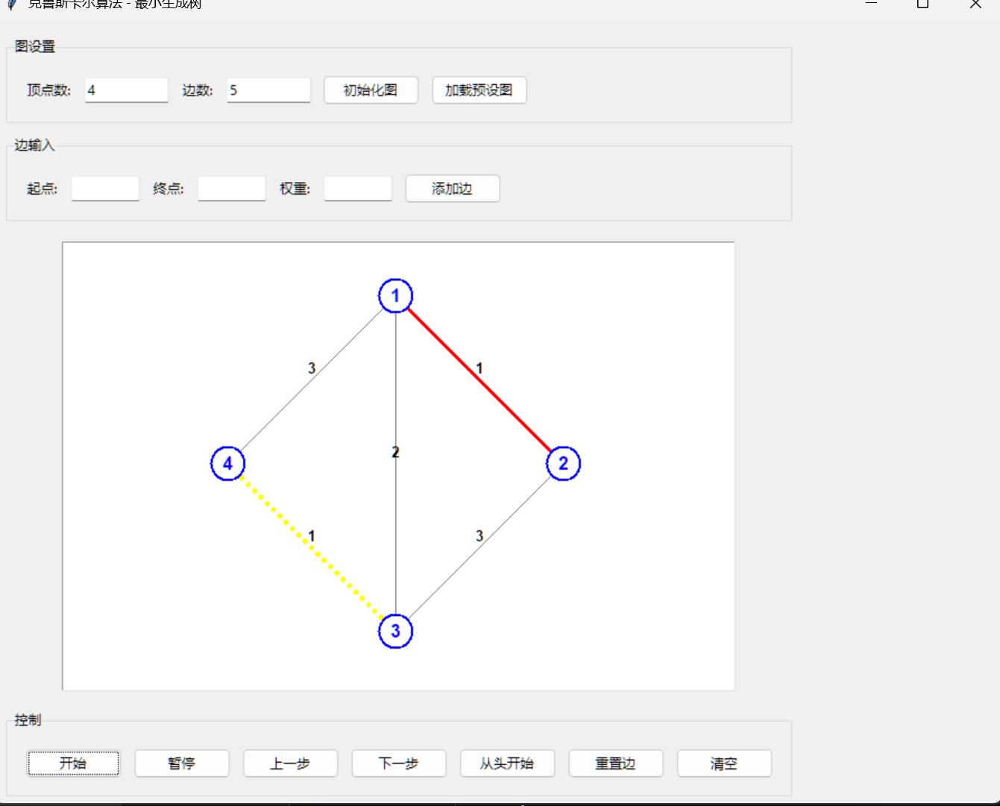
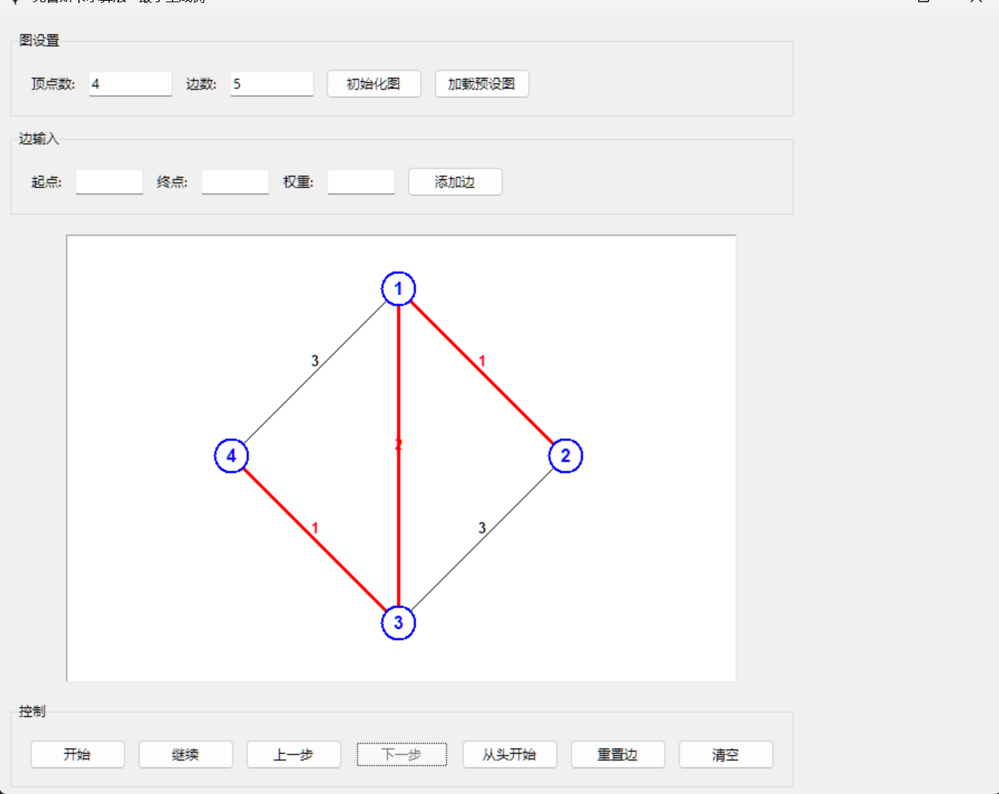

# Kruskal MST Visualizer

> 最小生成树（Kruskal 算法）教学可视化工具

[](https://github.com/Bludze/gitKruskal_2024042038/actions/workflows/ci.yml)
[](LICENSE)
[](https://www.python.org/)
[](src/c/kruskal.c)

Kruskal MST Visualizer 是一个面向数据结构教学的最小生成树演示工具。它把 Kruskal 算法的每个步骤拆解成可视化动画：边按权重排序、逐条考察、选中加入生成树、拒绝成环边，最终展示最小生成树与总权重。项目同时提供 C 语言命令行实现，便于与图形界面版本对照学习。

## 功能特性

- 图的初始化：自定义顶点数、边数，并校验 `边数 ≤ n(n-1)/2` 的简单图约束
- 边的录入：起点、终点、权重校验，重复边自动覆盖权重并提示
- 算法动画：排序、考察、选中、拒绝、完成五类步骤逐步高亮
- 播放控制：开始、暂停/继续、上一步、下一步、从头开始、重置边、清空
- 预设示例图：一键加载 4 顶点 5 边的演示数据
- 并查集实现：路径压缩 + 按秩合并
- C 语言命令行版本：标准输入输出，便于教学演示与性能对比
- 界面全中文提示，面向中文教学场景，降低初学者的使用门槛

## 效果预览

> 以下截图位于 `images/` 目录，上传仓库后按实际文件名替换。

| 图形界面                     | 算法动画                          |
| ---------------------------- | --------------------------------- |
|  |  |

| 运行结果                       | 分支与协作                        |
| ------------------------------ | --------------------------------- |
|  |  |

## 目录结构

```
.
├── .github/
│   ├── ISSUE_TEMPLATE/       # Issue 模板（缺陷 / 功能建议）
│   ├── PULL_REQUEST_TEMPLATE.md
│   └── workflows/ci.yml      # GitHub Actions 持续集成
├── docs/
│   ├── algorithm.md          # 算法原理与复杂度分析
│   └── architecture.md       # 代码结构与模块说明
├── images/                   # README 与文档截图
├── src/
│   ├── c/kruskal.c           # C 语言命令行实现
│   └── python/kruskal_gui.py # Python + tkinter 图形界面实现
├── tests/
│   └── test_kruskal.py       # 核心逻辑单元测试
├── CHANGELOG.md
├── CODE_OF_CONDUCT.md
├── CONTRIBUTING.md
├── LICENSE
├── README.md
└── requirements.txt
```

## 快速开始

### 环境要求

- Python 3.8 及以上（图形界面版）
- GCC / MSVC（C 命令行版，可选）

### Python 图形界面版

```bash
pip install -r requirements.txt
python src/python/kruskal_gui.py
```

启动后：

1. 输入顶点数与边数，点击「初始化图」
2. 逐条输入边的起点、终点、权重，点击「添加边」
3. 点击「开始」观看 Kruskal 算法逐步演示
4. 使用「暂停 / 上一步 / 下一步」控制演示节奏

也可以点击「加载预设图」直接体验示例。

### C 命令行版

Windows（MinGW 或 MSVC）：

```bash
gcc -O2 -o kruskal.exe src/c/kruskal.c
./kruskal.exe
```

Linux / macOS 需将 `src/c/kruskal.c` 中的 `#include <windows.h>` 与 `SetConsoleOutputCP` 两处平台相关代码移除或条件编译：

```bash
gcc -O2 -o kruskal src/c/kruskal.c
echo "3 3
1 2 1
2 3 2
1 3 3" | ./kruskal
```

预期输出：

```
最小生成树的边:
1 -- 2  权重=1
2 -- 3  权重=2
最小生成树总权重 = 3
```

## 算法说明

Kruskal 算法的核心是「按权重从小到大选边，用并查集判断是否成环」：

1. 将所有边按权重升序排序
2. 依次取出每条边，判断两个端点是否属于同一集合
3. 不属于同一集合则选中该边并合并集合；否则跳过（会成环）
4. 选满 `n - 1` 条边即得到最小生成树

时间复杂度 `O(E log E)`，空间复杂度 `O(V + E)`。详细推导见 [docs/algorithm.md](docs/algorithm.md)。

## 参与贡献

欢迎提交 Issue 与 Pull Request。请先阅读 [CONTRIBUTING.md](CONTRIBUTING.md)，并遵守 [CODE_OF_CONDUCT.md](CODE_OF_CONDUCT.md)。

协作流程：

1. Fork 本仓库并从 `main` 创建功能分支：`git checkout -b feature/your-feature`
2. 提交改动并推送到自己的远程分支
3. 向 `main` 发起 Pull Request，描述改动内容与验证方式
4. 等待维护者 Review，根据意见修改后合并

## 许可证

本项目采用 [MIT License](LICENSE) 发布。

## 致谢

- 算法思想参考《算法导论》第 23 章
- 并查集实现参考常见数据结构教材的路径压缩与按秩合并写法